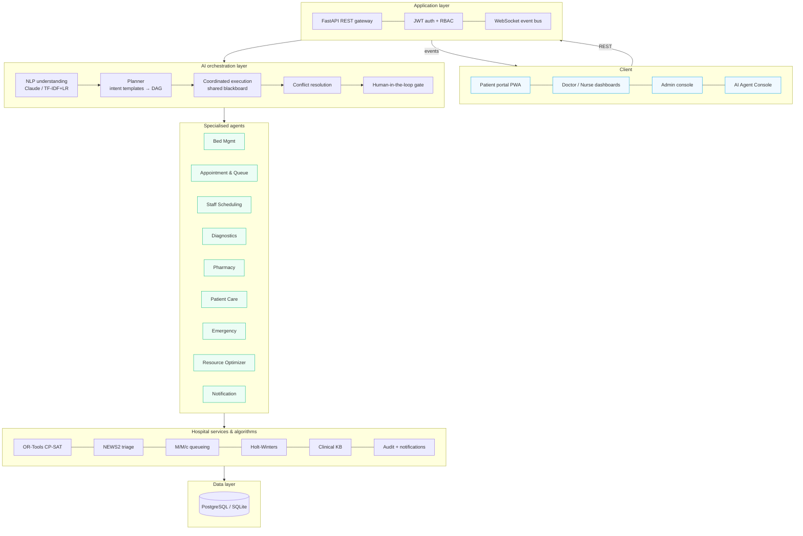
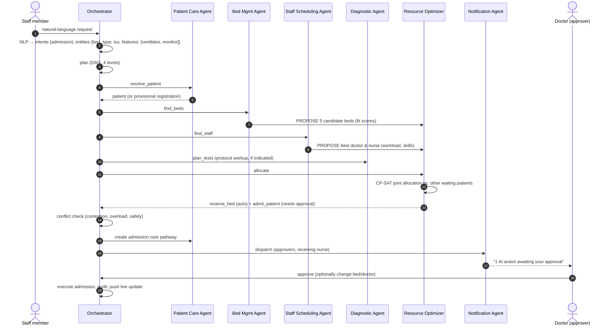
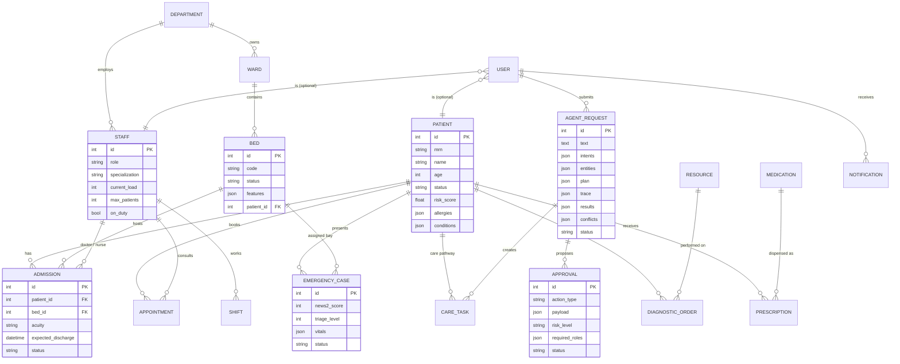
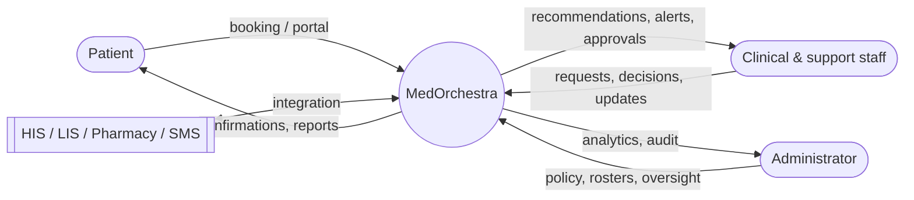
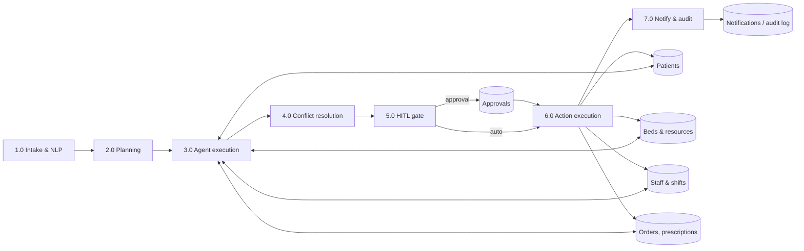
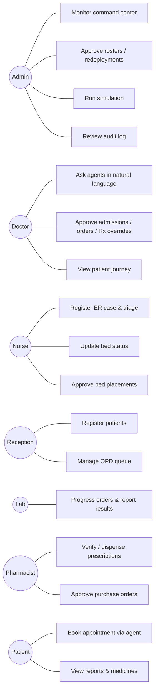
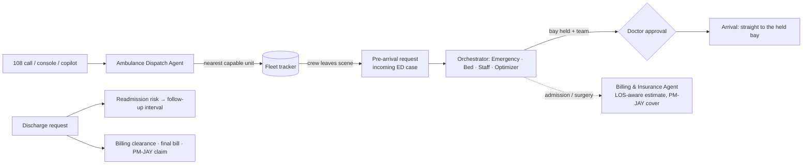

# MedOrchestra — Architecture & Design

This document contains the system design artefacts listed in the synopsis methodology (§7, *System Design*): architecture, agent workflow, ER diagram, DFDs and use cases, plus the algorithms used by each agent. Diagrams are written in Mermaid (render on GitHub, VS Code, or https://mermaid.live).

---

## 1. Layered architecture (synopsis §4.3)



**Integration layer.** HIS/LIS/pharmacy integration points are exposed as REST endpoints; SMS/e-mail are simulated notification channels; IoT (MQTT) is future scope.

---

## 2. Orchestration pipeline (synopsis §4.2, steps i–x)

| # | Synopsis step | Implementation (`backend/app/agents/orchestrator.py`) |
|---|---|---|
| i | Request intake | `Orchestrator.submit` → `AgentRequest` row; sources: console, emergency desk, patient portal, simulator |
| ii | NLP & classification | `understand_local` (TF-IDF word+char n-grams → Logistic Regression, clause-level multi-intent, regex entity extraction grounded on DB patients/medicines) or `LLMClient.understand` (Claude structured JSON output) merged with local grounding |
| iii | Workflow & resource identification | intent → workflow template (`TEMPLATES`) |
| iv | Agent selection | `build_plan` merges templates, deduplicates steps, computes topological levels |
| v | Coordination | agents run level by level, share a **blackboard** (`AgentContext.post`) and exchange **FIPA-ACL** messages (`INFORM`, `REQUEST`, `PROPOSE`, `REFUSE`) |
| vi | Constraint analysis | CP-SAT allocation, held-bed exclusion, `_resolve_conflicts` |
| vii | Recommendations & actions | `Recommendation` (with factor breakdown) and `ProposedAction` objects |
| viii | Human approval | `requires_approval` actions → `Approval` rows routed to roles by `APPROVER_ROLES` |
| ix | Execution | low-risk/reversible actions executed immediately; approved ones via `decide_approval` (with optional overrides) |
| x | Logging & monitoring | live trace over WebSocket, `AuditLog`, Notification Agent, request summary (Claude brief or template) |

### Example: "Patient needs admission and requires ICU monitoring"



---

## 3. Human-in-the-loop policy

| Action | Proposed by | Risk | Auto? | Approver roles |
|---|---|---|---|---|
| Hold (reserve) a bed | Optimizer | low | ✅ reversible | — |
| Admit patient / confirm ER bay + team | Optimizer | medium–critical | ❌ | doctor, admin |
| Diagnostic order explicitly requested by a prescriber | Diagnostic | low | ✅ | — |
| AI-suggested (protocol) workup | Diagnostic | medium | ❌ | doctor, admin |
| Prescription without alerts (by prescriber) | Pharmacy | low | ✅ → pharmacist verification queue | — |
| Prescription with major / contraindicated alert | Pharmacy | high/critical | ❌ doctor override | doctor, admin |
| Purchase order for low stock | Pharmacy | low | ❌ | pharmacist, doctor, admin |
| Book OPD appointment | Appointment | low | ✅ | — |
| Discharge | Patient Care | medium/high | ❌ | doctor, admin |
| Staff redeployment / roster publication | Staff | medium | ❌ | admin |
| Global bed placement | Optimizer | medium | ❌ | admin, nurse, receptionist |

Rejecting an approval releases any bed held for it and cancels the pending pathway tasks. Approvers may **modify** the AI's choice (bed, doctor, nurse, time, dose) before approving; the change is recorded in the audit log.

## 4. Conflict resolution rules

1. **Resource contention** — beds held by other pending approvals are excluded; the optimiser solves globally against ER patients already waiting, and a lower-priority request receives the next-best bed (logged as a conflict).
2. **Staff overload** — if a chosen clinician reaches capacity, the next-ranked candidate is substituted.
3. **Capacity** — a triage-L1 patient without a resus/ICU bed triggers a capacity alert to administrators; step-down or portable-equipment alternatives are proposed (e.g. *ICU bed + portable ventilator*).
4. **Safety refusals** — the Pharmacy Agent's `REFUSE` holds the prescription for explicit prescriber override.
5. **Serialisation** — allocation transactions run under an orchestrator lock, preventing double booking between concurrent requests.

---

## 5. Data model (ER diagram)



Other tables: `resources` (ORs, ventilators, imaging…), `medications`, `shifts`, `notifications`, `audit_logs`, `daily_stats` (historical analytics).

---

## 6. Data-flow diagrams

**Level 0 (context)**



**Level 1**



---

## 7. Use cases



---

## 8. Algorithms

### 8.1 NEWS2 early-warning score (Emergency Support Agent)

| Parameter | 3 | 2 | 1 | 0 | 1 | 2 | 3 |
|---|---|---|---|---|---|---|---|
| Resp. rate /min | ≤8 | | 9–11 | 12–20 | | 21–24 | ≥25 |
| SpO₂ % (scale 1) | ≤91 | 92–93 | 94–95 | ≥96 | | | |
| Supplemental O₂ | | yes | | no | | | |
| Systolic BP | ≤90 | 91–100 | 101–110 | 111–219 | | | ≥220 |
| Pulse | ≤40 | | 41–50 | 51–90 | 91–110 | 111–130 | ≥131 |
| Consciousness | | | | Alert | | | C/V/P/U = 3 |
| Temperature °C | ≤35.0 | | 35.1–36.0 | 36.1–38.0 | 38.1–39.0 | ≥39.1 | |

Risk: 0–4 low, any single 3 low-medium, 5–6 medium, ≥7 high. Triage: L1 if NEWS2 ≥7, unresponsive or critical red flags; L2 if 5–6, a single 3 or emergent red flags (chest pain, stroke signs…); L3 urgent; L4/L5 minor. Age ≥75 or ≤1 escalates one level. Target times follow Manchester Triage bands (0/10/60/120/240 min).

### 8.2 Bed allocation — CP-SAT (Resource Optimization Agent)

Decision variables `x[i,j] ∈ {0,1}` (patient *i* → bed *j*) exist only for **feasible** pairs (bed type allowed, required features present — hard constraints).

```
maximise   Σ x[i,j] · ( 1000·(6 − priority_i) − 10·cost[i,j] )
subject to Σ_j x[i,j] ≤ 1   ∀ patients      Σ_i x[i,j] ≤ 1   ∀ beds
cost[i,j] = 12·type_rank + 8·[other dept] + 2·|floor − dept floor| + 15·ward_occupancy
          + 20·(1 − nurse_coverage) + 6·missing_preferred + 4·wasted_premium_equipment
```

Priority dominates, so urgent patients are always placed first; the cost terms give an explainable, load-balanced choice. Fallback: Hungarian algorithm (SciPy).

### 8.3 Staff rostering — CP-SAT (Staff Scheduling Agent)

Variables `x[s,d,t]` (staff, day, shift ∈ {morning, evening, night}).
Constraints: ≤1 shift per day; no night → next-morning; ≤5 shifts/week; approved leave; coverage `Σ_s x[s,d,t] + shortfall ≥ required(dept, role, t)`.
Objective: `min 1000·Σ shortfall + 25·Σ(max_nights − min_nights) + 25·Σ(max_shifts − min_shifts) + Σ x` (coverage first, then fairness, then no over-staffing).

### 8.4 Queueing (Appointment & Queue Agent)

Each department is an **M/M/c** queue: λ = bookings/hour, μ = 60 / consult minutes, c = on-duty doctors.
Erlang-C `P(wait) = [a^c / (c!(1−ρ))] / [Σ_{k<c} a^k/k! + a^c/(c!(1−ρ))]`, `Wq = P(wait) / (cμ − λ)`.
Queue order uses a dynamic priority score with **ageing** (time waited) to prevent starvation: `20·(6 − priority) + 0.4·min(waited,180) + senior/child bonus + lateness`.

### 8.5 Demand forecasting — Holt-Winters (Resource Optimization Agent)

Additive triple exponential smoothing with weekly season *m* = 7:
`ℓ_t = α(y_t − s_{t−m}) + (1−α)(ℓ_{t−1}+b_{t−1})`, `b_t = β(ℓ_t − ℓ_{t−1}) + (1−β)b_{t−1}`, `s_t = γ(y_t − ℓ_t) + (1−γ)s_{t−m}`, `ŷ_{t+h} = ℓ_t + h·b_t + s_{t+h−m}`.
α, β, γ are chosen by grid search on one-step-ahead SSE; accuracy is reported as hold-out MAPE; a 95 % prediction interval widens with the horizon.

### 8.6 Operating-theatre scheduling (Resource Optimization Agent)

*Slot finder:* for each theatre, candidate starts are the requested lower bound and the end of every busy block; a
candidate is feasible if `[start, end + 30 min turnover)` overlaps no booking in that theatre, the surgeon is free, and an
elective case ends by 20:00 (urgent/emergency may run late). Options are ranked by `wait/15 + 10·theatre utilisation (+15 if overtime)`.

*Day re-optimisation (CP-SAT):* for every not-yet-started case *s* and theatre *o* an optional interval
`I[s,o] = (start_s, duration_s + turnover)` with presence `p[s,o]`; `Σ_o p[s,o] = 1`; `NoOverlap(I[·,o])` per theatre (plus fixed
intervals for cases already running); `NoOverlap` per surgeon.
Objective: `min Σ w_priority·start_s + 40·Σ overtime_s + 3·makespan + 20·Σ(theatre changes)` with w = 30 / 6 / 1 for emergency / urgent / elective.

### 8.7 Ward early warning & escalation

Each observation set is NEWS2-scored. Response policy (RCP 2017): 0 → 12-hourly; 1–4 → 4–6-hourly; 5–6 or any single 3 → hourly + urgent
doctor review; ≥ 7 → continuous monitoring, emergency alert to doctors and nurses and — if the patient is not already in ICU — an
automatic orchestrator request *"Transfer … to ICU"*, which the Bed, Staff and Optimizer agents turn into a transfer proposal awaiting
doctor approval. Thresholds are configurable in *System & Policy*.

### 8.8 Length-of-stay prediction (machine learning)

`GradientBoostingRegressor` (180 trees, depth 3) on age, acuity, comorbidity count, emergency admission and ward type, plus two
quantile models (α = 0.1 / 0.9) for an 80 % prediction interval. Trained on a synthetic historical-admission set (4 000 rows, gamma-distributed
stays); the model card reports hold-out MAE against a naive median-stay baseline, R² and interval coverage. The optimizer uses the
prediction to set the expected discharge date and explains it in the approval rationale.

### 8.9 Autonomy policy (HITL)

| Mode | Behaviour |
|---|---|
| Supervised | Every agent action waits for approval |
| Balanced (default) | Low-risk reversible actions auto-execute; clinical/risky actions need approval |
| Autonomous | Low/medium-risk operational actions auto-execute; high/critical risk, prescribing, discharge, staffing and AI-suggested workups still need approval |

### 8.10 NLP understanding

- **Local:** TF-IDF (word 1–2-grams ∪ char 3–5-grams) → multinomial Logistic Regression over 11 intents; clause-level classification plus word-bounded keyword rules add secondary intents; suppression rules stop hospital-level questions ("forecast admissions") from spawning patient workflows. Entities by regex + DB grounding (patient names/MRN, medicines), vitals (with °F→°C), bed types/features, tests (longest-match), departments, dates/times, staff counts.
- **Claude (optional):** `claude-opus-5` with a strict JSON schema (`output_config.format`), low effort, server-side refusal fallbacks; merged with the local DB-grounded entities. Claude also writes the coordination brief. Any LLM failure falls back to the local pipeline.
- **Hinglish:** a rule-based normaliser (`services/hinglish.py`) rewrites Romanised Hindi phrases ("kitne bed khali hain", "seene mein dard", "usko kal book karo") into English before classification; pronouns become a marker that the copilot resolves from conversation memory. Patient names are masked before intent classification (entity masking) so a name never sways the intent.
- **Validation:** 5-fold *GroupKFold* (all paraphrase variants of a sentence in one fold → no leakage) plus a 24-sentence held-out set incl. Hinglish; both are reported live on the AI Governance page.

---

## 9. v2 modules (beyond the synopsis)



| Module | Where | Key idea |
|---|---|---|
| Ambulance & pre-hospital | `agents/ambulance_agent.py`, `services/dispatch.py`, `routers/ambulance.py` | explainable unit ranking, accelerated live tracking, `incoming` ED cases, bay *reserved* until arrival |
| Digital twin | `services/digital_twin.py`, `routers/twin.py` | discrete-event Monte Carlo from live state; common random numbers; lever search → recommendations |
| Billing & insurance | `agents/billing_agent.py`, `services/billing.py`, `routers/billing.py` | idempotent charge capture (`source_ref`), PM-JAY per-day / surgical packages, TPA co-pay, claims, clearance |
| Readmission risk | `services/readmission.py` | LACE index + logistic regression; drives the follow-up interval |
| ICU central monitor | `services/telemetry.py`, `routers/monitor.py` | mean-reverting telemetry, persistence-filtered smart alarms, WebSocket stream |
| Copilot | `routers/copilot.py`, `components/Copilot.tsx` | Hinglish normalisation, conversation memory, clarification questions |
| Documentation | `routers/docs.py` | AI-drafted SOAP notes (draft → clinician signs), SBAR handover |
| Governance | `routers/governance.py` | HITL rates, decision latency, autonomy ratio, model cards, safety & access metrics |
| Public screens | `routers/public.py` | token-only TV display, MRN + phone-digit kiosk with rate limiting |
| Security | `security.py`, `main.py` | login lock-out, password policy, security headers, request IDs, record-access log |

### 9.1 Ambulance unit selection

For a call at location *p* with predicted triage level *L* (NEWS2 + red flags from paramedic vitals / complaint):

```
eta(u)  = haversine(u, p) × 1.35 (road factor) ÷ speed(time of day) × 60 + 1 min turnout
cost(u) = eta(u) + 6·[L ≤ 2 and u is BLS] + 4·[u is the hospital's own ALS unit and L ≥ 3]
```
The lowest-cost unit is dispatched automatically (life-critical actions are exempt from approval holds in every autonomy mode). When the crew leaves the scene, an `incoming` emergency case is created and the Emergency → Bed → Staff → Optimizer pipeline runs; the approved bay is **reserved** (not occupied) until arrival, when the patient goes straight into it.

### 9.2 Digital twin

State at *t = 0*: occupied beds (remaining stay from expected discharge), beds being cleaned, ED patients in work-up, waiting, or boarding. Events: ED arrival (Poisson, hour-of-day profile × surge), ED decision after exponential work-up (admission probability by triage level, critical-care need by level), elective admission (08:00–14:00), discharge (log-normal LOS, only 09:00–20:00), bed turnaround (45 min). Staff absence beyond a 10 % float pool closes beds proportionally. KPIs per replication: occupancy, boarding patient-hours, P90 boarding wait, ED saturation hours, cancelled electives. *R* replications for baseline and scenario share random streams (**common random numbers**), so the comparison is low-variance and reproducible. Recommendations: each lever (surge beds, discharge lounge, rapid turnaround, criteria-led discharge, elective deferral) is simulated and ranked by the reduction of `boarding + 3·ED-saturation + 4·cancellations`.

### 9.3 Billing engine

Every billable event maps to a charge with a stable `source_ref` (`room:<adm>`, `dx:<order>`, `rx:<prescription>`, `sx:<surgery>`, …), so re-syncing updates quantities (bed-days grow) without duplicates. Coverage: **PM-JAY** — the surgical package if a procedure was performed, otherwise the per-day medical package for the highest level of care (routine ward / HDU / ICU / ICU + ventilator); cashless, the difference is a hospital package adjustment. **Private TPA** — 90 % up to a ₹3 lakh sum insured. Estimates use the LOS model's P10/P50/P90 stay.

### 9.4 Readmission risk (LACE)

`L` length of stay (0–7), `A` emergent admission (3), `C` Charlson index from the problem list (0–5), `E` ED visits in 6 months (0–4). A logistic regression on LACE, age, critical-care stay, polypharmacy and abnormal results gives a probability; ≥ 20 % → high → follow-up in 5 days and a 48-hour phone call; 10–20 % → 10 days; otherwise 14 days.

### 9.5 Smart alarms

A limit breach (e.g. SpO₂ < 90 %, HR > 130, SBP < 90) must persist for 3 consecutive readings before it alarms; shorter breaches are counted as suppressed artefacts — the monitor shows how many alarms this avoided.
